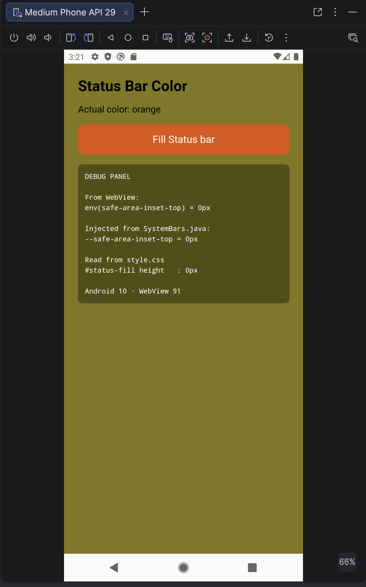
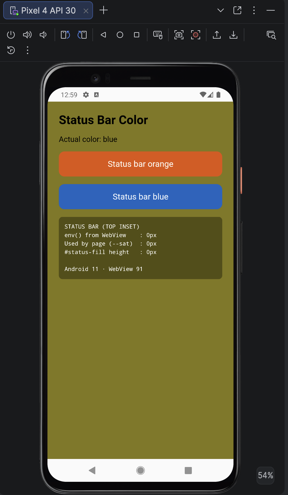
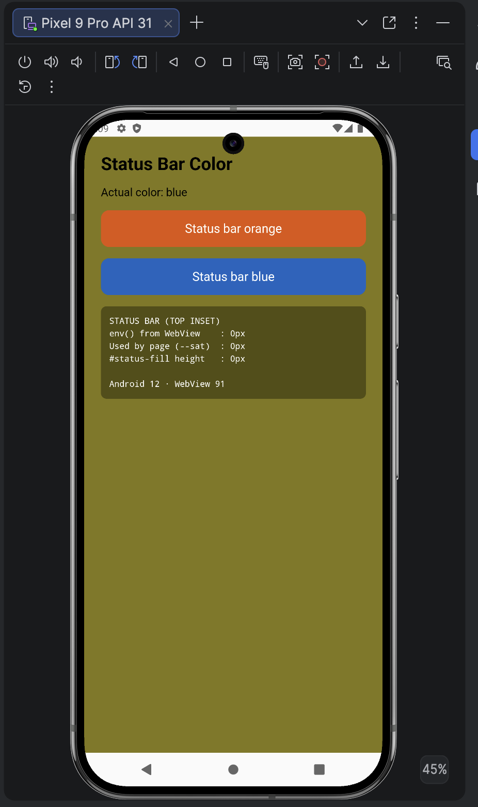
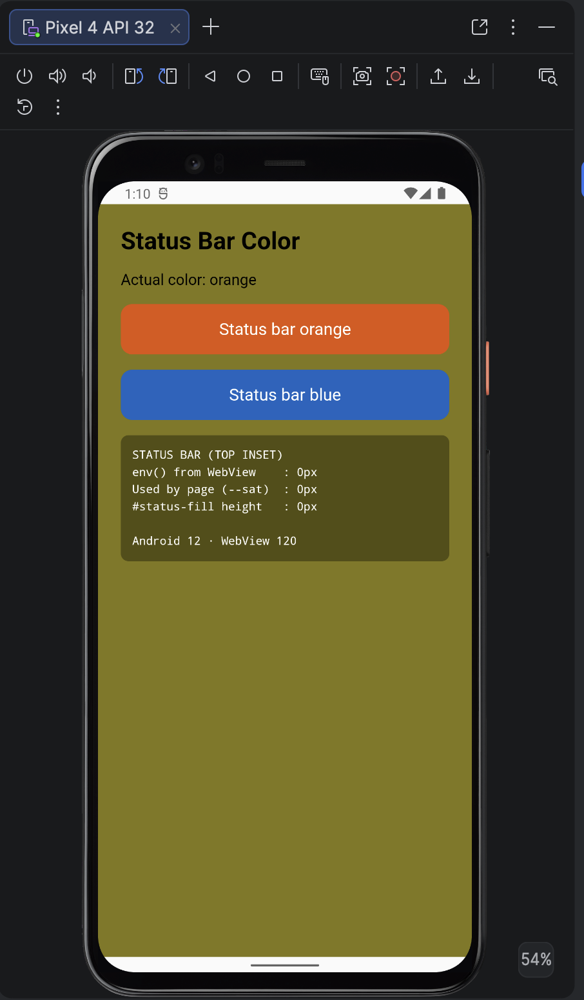
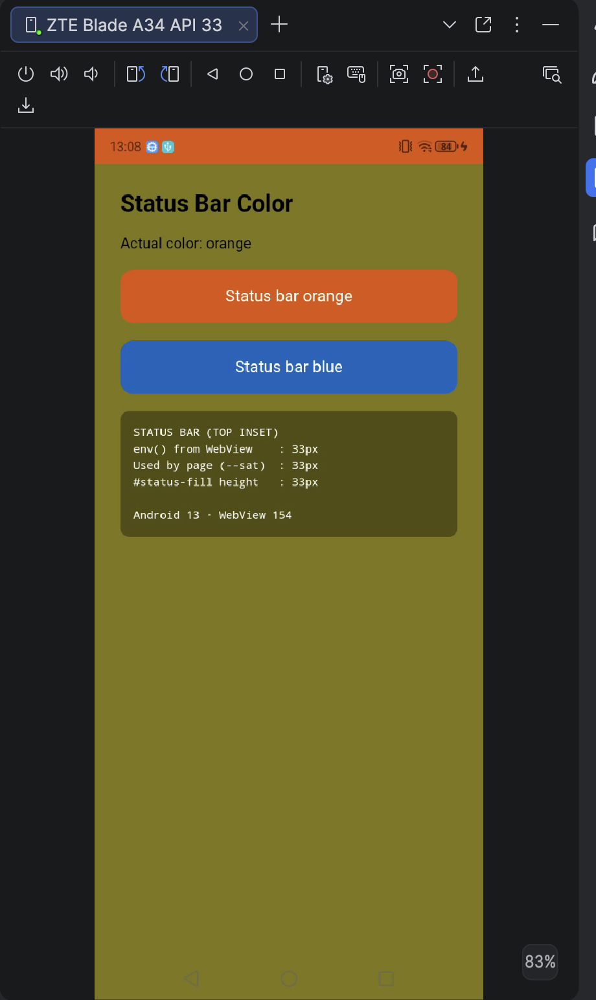
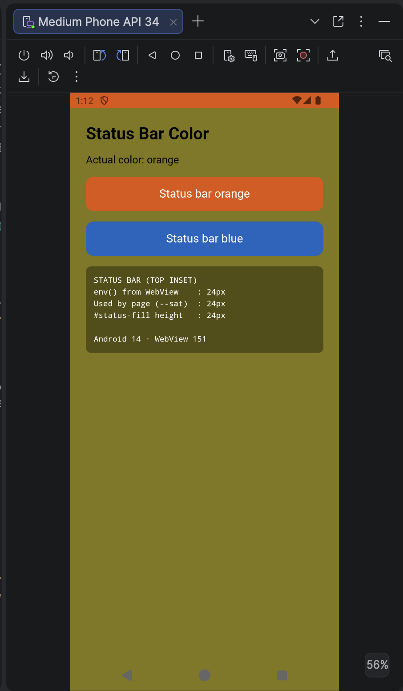
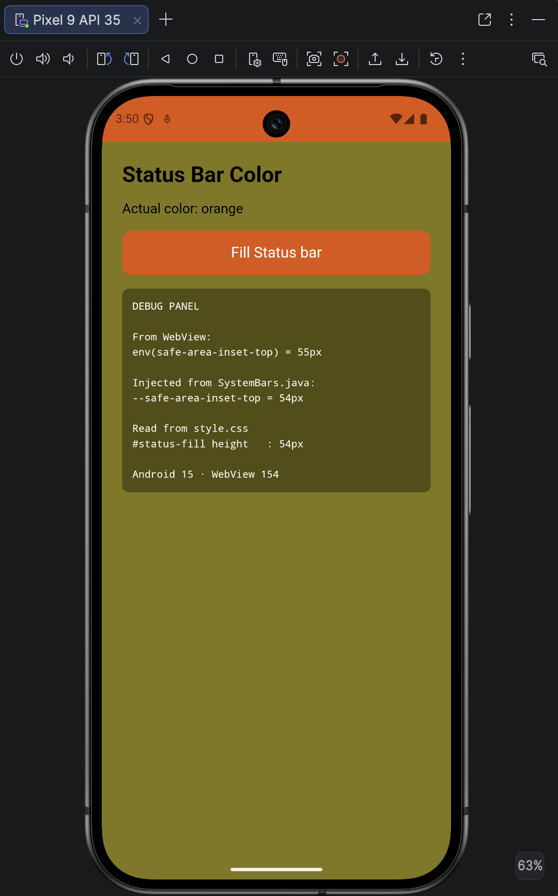
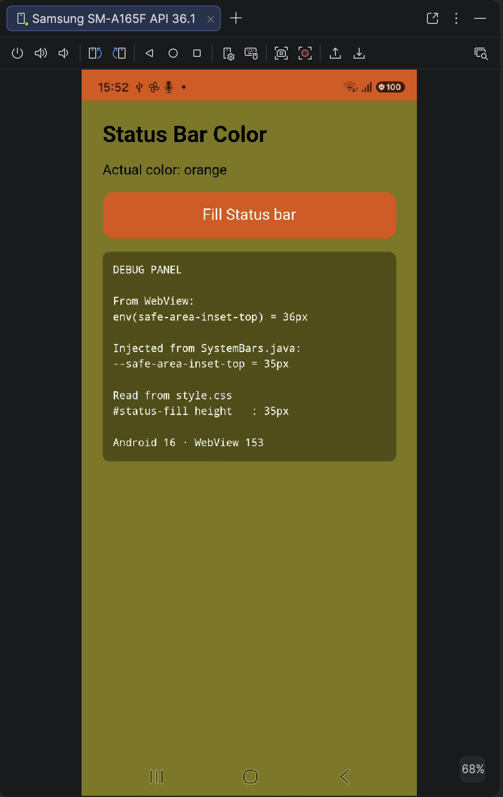
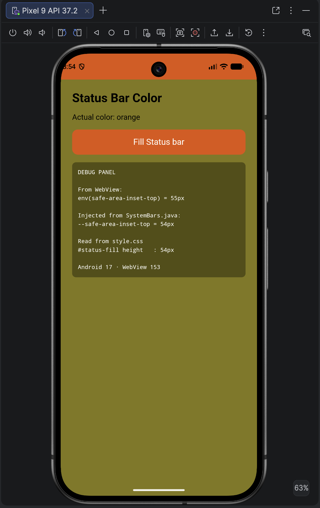

# Capacitor SystemBars – status bar inset reproduction (Android 10 → 17)

Minimal vanilla JS app (no bundler) to check how the **SystemBars** plugin bundled in `@capacitor/core`
exposes the **status bar (top) inset** to the web page on Android 10 to 17 (API 29 → 37).

The page reads the top inset and shows it in a debug panel:

| Source | How the page reads it |
|---|---|
| From WebView | `env(safe-area-inset-top)` |
| Injected from SystemBars.java | `--safe-area-inset-top` |
| Read from style.css | `#status-fill.height = var(--sat)`<br>--sat variable is set to `--sat: var(--safe-area-inset-top, env(safe-area-inset-top, 0px))` |

A fixed `#status-fill` element (height = `--sat`) is painted behind the status bar, so a wrong inset is visible on screen.

## Environment

| | |
|---|---|
| `@capacitor/core` / `@capacitor/android` / `@capacitor/cli` | **8.5.3** (pinned) |
| `minSdkVersion` / `compileSdkVersion` / `targetSdkVersion` | 24 / 36 / 36 |
| `androidx.activity` | 1.11.0 |
| Edge-to-edge | enabled |
| Viewport | `viewport-fit=cover` |
| SystemBars config | none (defaults: `insetsHandling: "css"`) |

`android/app/src/main/java/.../MainActivity.java` (included in this repository):

```java
import android.os.Bundle;
import androidx.activity.EdgeToEdge;
import com.getcapacitor.BridgeActivity;

public class MainActivity extends BridgeActivity {
    @Override
    protected void onCreate(Bundle savedInstanceState) {
        super.onCreate(savedInstanceState);
        EdgeToEdge.enable(this);
    }
}
```

## Quick start

Requirements: Node 22+, Android Studio, JDK 21.

```bash
git clone https://github.com/adrianofalleti98/capacitor-systembars-repro.git
cd capacitor-systembars-repro
npm install
npx cap sync android
```

Run on an emulator/device:

```bash
npx cap run android --list            # list available devices/emulators
npx cap run android --target <id>     # run on a specific one
```

or open the project in Android Studio:

```bash
npx cap open android
```

## How to test

1. Launch the app.
2. Read the debug panel right after the page is visible.
3. Tap Fill status bar button to set status bar color

Debug panel legend:

```
DEBUG PANEL

From WebView:
env(safe-area-inset-top) = value reported by the WebView

Injected from SystemBars.java:
--safe-area-inset-top = value written by injectSafeAreaCSS() on <html>

Read from style.css
#status-fill height   : height of the colored rectangle behind the status bar

Android <version> · WebView <major>
```

Useful while testing:

- **Web console:** `chrome://inspect` in Chrome on the Mac → *inspect* under the app WebView.
- **Native logs:** Logcat in Android Studio, filter `SystemBars` / `Capacitor/Console`.

## Tested on

| Android | API | Device / emulator | WebView | `--safe-area-inset-top` | `env(safe-area-inset-top)` | `#status-fill height` | Result |
|---|---|---|---|---|---|---|---|
| 10 | 29 | Medium Phone (emulator) | 91 | 0px | 0px | 0px | ❌ Not edge-to-edge, no inset exposed |
| 11 | 30 | Pixel 4 (emulator) | 91 | 0px | 0px | 0px | ❌ Same as Android 10 |
| 12 | 31 | Pixel 9 Pro (emulator) | 91 | 0px | 0px | 0px | ❌ Same as Android 10 |
| 12L | 32 | Pixel 4 (emulator) | 120 | 0px | 0px | 0px | ❌ Same as Android 10 |
| 13 | 33 | ZTE Blade A34 | 154 | 33px | 33px | 33px | ✅ Correct |
| 14 | 34 | Medium Phone (emulator) | 151 | 24px | 24px | 24px | ✅ Correct |
| 15 | 35 | Pixel 9 (emulator) | 154 | 54px | 55px | 54px | ✅ Correct (1px difference, see below) |
| 16 | 36 | Samsung SM-A165F (Galaxy A16, API 36.1) | 153 | 35px | 36px | 35px | ✅ Correct (1px difference, same as Android 15) |
| 17 | 37 | Pixel 9 (emulator, API 37.2) | 153 | 54px | 55px | 54px | ✅ Correct (1px difference, same as Android 15) |

## Observations

### Android 10 (API 29) – Medium Phone emulator, WebView 91



- The page is **not** drawn edge-to-edge, even though `EdgeToEdge.enable(this)` is called in `MainActivity`:
  the WebView content is laid out **between** the status bar and the navigation bar, and both bars have a white background.
- After tapping **Fill Status bar**, the area behind the status bar stays white: `#status-fill` has no height.
- Debug panel: `env(safe-area-inset-top) = 0px`, `--safe-area-inset-top = 0px`, `#status-fill height : 0px`.

Related code in `SystemBars.java` (8.5.3): with WebView < 140 (`WEBVIEW_VERSION_WITH_SAFE_AREA_FIX`),
`shouldPassthroughInsets` is `false`, so `initWindowInsetsListener()` applies the system bar insets as padding on the
decor view (`v.setPadding(left, top, right, bottom)`) and passes zeroed insets to the WebView and to `injectSafeAreaCSS()`.

### Android 11 (API 30) – Pixel 4 emulator, WebView 91



Same behavior as Android 10:

- The page is laid out **between** the status bar and the navigation bar, and both bars have a white background.
- After tapping **Fill Status bar**, the area behind the status bar stays white: `#status-fill` has no height.
- Debug panel: `env(safe-area-inset-top) = 0px`, `--safe-area-inset-top = 0px`, `#status-fill height : 0px`.

### Android 12 (API 31) – Pixel 9 Pro emulator, WebView 91



Same behavior as Android 10:

- The page is laid out **between** the status bar and the navigation bar, and both bars have a white background.
- After tapping **Fill Status bar**, the area behind the status bar stays white: `#status-fill` has no height.
- Debug panel: `env(safe-area-inset-top) = 0px`, `--safe-area-inset-top = 0px`, `#status-fill height : 0px`.
- The punch-hole camera extends below the status bar and overlaps the top edge of the page content.

### Android 12L (API 32) – Pixel 4 emulator, WebView 120



Same behavior as Android 10 (WebView 120 is still below 140):

- The page is laid out **between** the status bar and the gesture navigation bar, and both bars have a white background.
- After tapping **Fill Status bar**, the area behind the status bar stays white: `#status-fill` has no height.
- Debug panel: `env(safe-area-inset-top) = 0px`, `--safe-area-inset-top = 0px`, `#status-fill height : 0px`.
- The user agent reports `Android 12` on this API level.

### Android 13 (API 33) – ZTE Blade A34, WebView 154



Correct:

- The page is drawn edge-to-edge, also behind the navigation bar.
- After tapping **Fill Status bar**, `#status-fill` covers exactly the status bar area (orange).
- Debug panel: `env(safe-area-inset-top) = 33px`, `--safe-area-inset-top = 33px`, `#status-fill height : 33px`.

### Android 14 (API 34) – Medium Phone emulator, WebView 151



Correct:

- The page is drawn edge-to-edge, also behind the navigation bar.
- After tapping **Fill Status bar**, `#status-fill` covers exactly the status bar area (orange).
- Debug panel: `env(safe-area-inset-top) = 24px`, `--safe-area-inset-top = 24px`, `#status-fill height : 24px`.

### Android 15 (API 35) – Pixel 9 emulator, WebView 154



Correct:

- The page is drawn edge-to-edge, also behind the gesture navigation bar.
- After tapping **Fill Status bar**, `#status-fill` covers the status bar area (orange), including the punch-hole camera area.
- Debug panel: `env(safe-area-inset-top) = 55px`, `--safe-area-inset-top = 54px`, `#status-fill height : 54px`.

`env(safe-area-inset-top)` and `--safe-area-inset-top` differ by 1px. In `injectSafeAreaCSS()` the inset is converted
to CSS px and then cast with `(int) topPx`, which truncates the decimal part, while the WebView value is not truncated
the same way.

### Android 16 (API 36.1) – Samsung SM-A165F, WebView 153



Correct:

- The page is drawn edge-to-edge, also behind the navigation bar.
- After tapping **Fill Status bar**, `#status-fill` covers the status bar area (orange).
- Debug panel: `env(safe-area-inset-top) = 36px`, `--safe-area-inset-top = 35px`, `#status-fill height : 35px`.

Same 1px difference as Android 15 (truncated by `(int) topPx` in `injectSafeAreaCSS()`).

### Android 17 (API 37.2) – Pixel 9 emulator, WebView 153



Correct:

- The page is drawn edge-to-edge, also behind the gesture navigation bar.
- After tapping **Fill Status bar**, `#status-fill` covers the status bar area (orange), including the punch-hole camera area.
- Debug panel: `env(safe-area-inset-top) = 55px`, `--safe-area-inset-top = 54px`, `#status-fill height : 54px`.

Same 1px difference as Android 15 (truncated by `(int) topPx` in `injectSafeAreaCSS()`).
